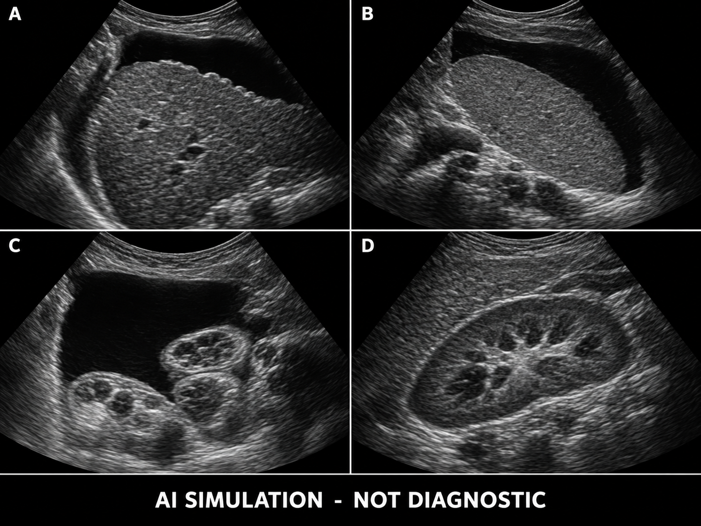
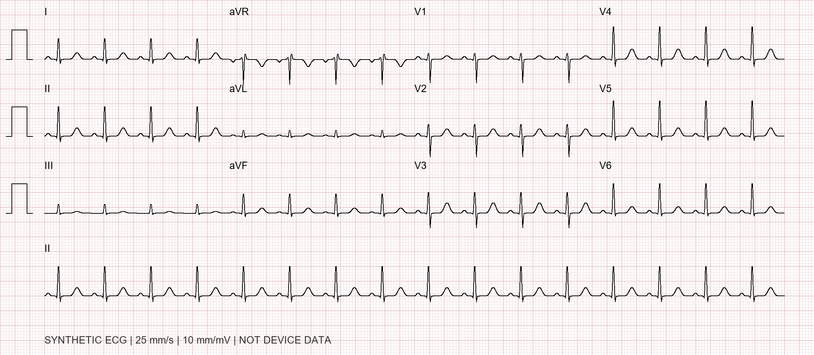

# Inpatient Medical Record Copy · Expert-Review Edition

## Case topic

Worsening ascites in decompensated hepatitis B cirrhosis, complicated by spontaneous bacterial peritonitis and acute kidney injury; discharged with improvement after antimicrobial treatment, volume management, and ascites treatment.

| Item | Information |
| --- | --- |
| Name / Sex / Age | Wang Jianhua (fictional） / male / 56 years old |
| Department / Bed number | Gastroenterology (Hepatology Ward) / Simulated Bed 12 |
| Medical record number | SIM-ASC-20260901 |
| Admission / Discharge | 2026-09-01 09:20 / 2026-09-09 10:00 |
| Length of hospital stay | 8 Days (spanning 9 calendar dates） |
| Material version | v1.1 / 2026-09-15 / Pending clinical expert review |
| Uses | Clinical reasoning training for senior residents and review by clinical experts. |

## Document properties

All identities, clinical conditions, laboratory values, microbiology results, and procedural events in this booklet are synthetic teaching material and do not come from real patients. This booklet is the complete answer case record and includes final diagnoses; it should not be given in full to trainees during the initial consultation stage of an examination.

## Images and sign-off

The ultrasound image is an AI-generated illustration, and the ECG is an algorithmically drawn illustration. The written reports are case assumptions; the images cannot validate measurements and cannot serve as a gold standard for interpreting real images in examinations. No real hospital logos or seals are included; the footer contains a simulated handwritten signature of a fictitious physician.

## Material components

Medical record face sheet, admission note, initial and daily progress notes, laboratory and examination reports, abdominal paracentesis and therapeutic ascites drainage records, summary of order implementation, nursing monitoring, and discharge summary. Teaching objectives, staged disclosure, and review forms are provided separately.

# Inpatient medical record front sheet

| Registration items | Registration details |
| --- | --- |
| Name | Wang Jianhua (fictional） |
| Date of birth / Age | 1970-04-18 / 56 years old |
| Sex / Ethnicity / Marital status | male / Han Chinese / Married |
| Occupation / Place of origin | Warehouse Administrator / Chengdu, Sichuan |
| Current address | Room 502, Building 3, Jinhe Yuan, 36 Jinhe Road, Wuhou District, Chengdu, Sichuan Province. |
| Contact person / History provided by | Wife (Family Member Role A) / Patient, supplemented by wife; generally reliable. |
| Route of admission | Admitted from the gastroenterology outpatient clinic |
| Admission diagnosis | Decompensated hepatitis B cirrhosis with worsening ascites; intra-abdominal infection to be ruled out; renal dysfunction requiring investigation. |
| Principal discharge diagnosis | Decompensated hepatitis B cirrhosis with ascites |
| Other discharge diagnoses | Spontaneous bacterial peritonitis (Escherichia coli); stage 1 acute kidney injury (resolved); hyponatremia (improved); portal hypertension, splenomegaly with thrombocytopenia; hypoalbuminemia |
| Clinical procedures | 09-01 diagnostic paracentesis; 09-03 repeat paracentesis; 09-04 therapeutic paracentesis, 6000 mL removed. |
| Surgery / Blood transfusion | No surgery, TIPS, or liver transplantation was performed; no red blood cells, plasma, or platelets were transfused. See separate orders for human albumin administration. |
| Drug allergy / Outcome | Denies known drug allergies / Discharged with improvement |

Diagnostic codes, charges, actual identification numbers, signatures, and seals have not been fabricated. This page is a teaching template for a medical-record front sheet, not a front sheet for administrative submission.

# Admission Record (1) · Chief Complaint and History of Present Illness

Record time：2026-09-01 10:00

## Chief complaint

Recurrent abdominal distension for 6 months, worsening with lower-extremity edema for 10 days and decreased urine output for 2 days.

## History of present illness

The Patient was found to be hepatitis B surface antigen-positive during a health examination 20 years ago and was diagnosed with hepatitis B-related cirrhosis by liver imaging and blood tests 3 years ago. Abdominal distension and bilateral lower-extremity edema first developed 6 months ago and improved with outpatient antiviral and oral diuretic treatment; there was no hospitalization or paracentesis. Abdominal girth has been essentially stable over the past month. On August 20, weight was 68 kg and creatinine was 78 μmol/L.

Abdominal distension gradually worsened after a group meal and increased consumption of preserved foods 10 days ago, with a tighter waistband, early satiety, and bilateral ankle edema extending to the lower legs. From August 28 to 30, the patient independently increased furosemide from 20 mg/day to 40 mg/day while continuing spironolactone at 50 mg/day, without significant relief of abdominal distension. Over the past 3 days, food intake has been approximately half the usual amount, with water intake of approximately 1000 mL/day. Over the past 2 days, estimated urine output decreased from approximately 1500 mL/day to 800–1000 mL/day, with dark urine and worsening fatigue after activity.

No chills; maximum self-measured temperature 37.4°C. Only mild, diffuse, dull abdominal pain, without persistent, localized severe pain. No vomiting, diarrhea, hematemesis, or melena; recent stools have been yellow-brown, once daily. No cough, sputum production, or dysuria; no sleep–wake reversal, abnormal behavior, or confusion. Able to lie flat at night, with no chest pain or orthopnea. Marked ascites and relatively low blood pressure were noted at today’s outpatient visit, prompting admission.

## Recent medication use and exposures

Regularly takes entecavir 1 mg/day (previous decompensation), spironolactone 50 mg/day, and furosemide 20 mg/day; had not yet taken diuretics on the day of admission. Denies recent NSAIDs, Chinese herbal medicines, contrast agents, or other nephrotoxic drugs. No hospitalization or antibiotic use in the past 3 months, and no known history of colonization with resistant organisms.

Since onset, slightly reduced energy, sleep affected by abdominal distension, and decreased appetite. Recent weight gain is primarily attributed to fluid retention; weight gain does not exclude nutritional risk.

# Admission Record (II) · Past Medical, Personal, and Family History

## History of liver disease

Hepatitis B for approximately 20 years; follow-up was irregular initially. Started entecavir 1 mg once daily on an empty stomach after developing ascites 6 months ago; denies missed doses or prior use of nucleoside analogues such as lamivudine. No prior SBP, hepatic encephalopathy, gastrointestinal bleeding, liver cancer, or portal vein thrombosis.

## Previous examinations

2026-06-15 outpatient gastroscopy summary: small varices in the lower esophagus, without red signs or active bleeding; mild portal hypertensive gastropathy. A nonselective beta-blocker has not yet been started because outpatient systolic blood pressure is usually 95–100 mmHg, with occasional dizziness; hepatology reassessment is planned. On 2026-08-20, creatinine was 78 μmol/L, sodium 135 mmol/L, and potassium 4.2 mmol/L; there was no significant edema at that time, and weight was 68 kg. The above is a summary of historical records; no original gastroscopy images have been fabricated.

## Other past medical history

Denies a history of hypertension, diabetes, coronary artery disease, heart failure, chronic kidney disease, tuberculosis, or malignancy. No history of surgery, trauma, or transfusion. Vaccination details are unknown. Denies known food or drug allergies.

## Personal history

Born in and a long-term resident of Chengdu, Sichuan; married, lives with his wife, and has one son. Approximately 10 pack-years of smoking; quit 5 years ago. Previously drank small amounts of alcohol; stopped after diagnosis of cirrhosis. No intravenous drug use, tattoos, or recent exposure to contaminated water in endemic areas. Work mainly involves standing and light manual handling.

## Family history

Mother is hepatitis B surface antigen positive; no known history of liver cancer. Father has hypertension. No known hereditary liver or kidney disease.

## Review of systems

No recent significant weight loss or night sweats; no chest tightness, palpitations, or unilateral lower-limb swelling and pain; no frequent small-volume urination, hematuria, or foamy urine; no rash or joint swelling and pain; no visual abnormalities or focal neurological symptoms.

Recording physician: Zhao Heng (simulated signature for teaching)

# Admission note (3）· Physical examination

| Item | Results |
| --- | --- |
| Vital signs | T 37.3℃；P 96 times/min；R 20 times/min；BP 98/62 mmHg；SpO2 97%（Air） |
| Height / Body weight / Abdominal circumference | 170 cm / 76.0 kg / 106 cm; recent weight of 68 kg without edema used as estimated dry weight. |
| General condition | Alert and fully oriented, with features of chronic liver disease; mild scleral icterus, palmar erythema, and spider angiomas on the upper chest |
| Nutrition and skin | Reduced muscle bulk at the temples and upper arms; skin intact, with no active ecchymoses or foci of infection. |
| Head and neck | No jugular venous distention or palpable superficial lymphadenopathy |
| Cardiopulmonary | Heart rate 96/min, regular rhythm, no appreciable murmur; clear breath sounds bilaterally, no crackles |
| Abdominal inspection and palpation | Distended abdomen, slightly tense abdominal wall, and flat umbilicus; mild diffuse tenderness without rebound tenderness or guarding; liver not palpable below the costal margin, spleen approximately 2 cm below the costal margin… |
| Abdominal percussion and auscultation | Positive shifting dullness and fluid wave; bowel sounds 4/min; no appreciable vascular bruit |
| Urinary system and extremities | No tenderness to percussion over the renal areas; symmetric 2+ pitting edema of both lower legs; extremities warm. |
| Nervous system | No asterixis, pathological reflexes, or focal signs. |

## Initial assessment on admission

Features of decompensated cirrhosis and marked ascites are present. Despite the absence of high fever, mild abdominal pain, reduced urine output, and relatively low blood pressure warrant priority assessment for intra-abdominal infection and circulatory perfusion; this must not be managed solely as “hypoproteinemic edema.”

# Initial progress note

Recorded: 2026-09-01 10:20 (ascitic fluid results were not yet available).

## Case features

A 56-year-old man with hepatitis B cirrhosis and prior ascites, with worsening abdominal distension and edema for 10 days and reduced urine output for 2 days. Recent high-salt diet, self-increased diuretic doses, and reduced food intake. Examination shows ascites, mild abdominal pain, and low-normal blood pressure, without peritoneal signs or altered consciousness.

## Preliminary diagnosis and supporting evidence

1. Decompensated hepatitis B cirrhosis with worsening ascites: supported by prior cirrhosis and ascites and current findings. 2. Intra-abdominal infection to be excluded: absence of fever does not exclude SBP. 3. Renal dysfunction requiring investigation: compare with prior baseline and urine output.

## Differential diagnosis

Causes of ascites include portal hypertensive, cardiac, malignant, and tuberculous ascites. Assess SAAG and ascitic fluid protein first, then select further tests based on the findings. The differential diagnosis of oliguria includes hypoperfusion related to inadequate intake/diuretics, infection-related kidney injury, HRS-AKI, intrinsic renal injury, and obstruction. Persistent localized abdominal pain or polymicrobial cultures should raise concern for secondary peritonitis.

## Diagnostic and treatment plan

Withhold spironolactone and furosemide; record blood pressure, urine output, weight, and fluid intake and output. Urgently obtain a complete blood count, liver and renal function tests, electrolytes, coagulation tests, CRP, lactate, urinalysis/sediment examination, and blood cultures. Perform ultrasound assessment and diagnostic paracentesis as early as possible; send ascitic fluid for differential cell count, albumin, total protein, glucose, LDH, and culture. Bedside inoculation of ascitic fluid must be completed before antibiotics are administered.

Assess peritoneal signs, hemodynamics, and respiratory status. Decide on antimicrobial therapy immediately after rapid ascitic fluid results are available; do not wait for final culture results. Base albumin and fluid strategies on clinical volume status; do not overlook circulatory perfusion because of large-volume ascites or administer large volumes of fluid indiscriminately. Continue antiviral therapy and review dosing against renal function. Explain the diagnosis and purpose of paracentesis to the Patient and family.

Supervising Physician Review: Shen Yan; Recorded by: Zhao Heng (both simulated teaching signatures).

# Complete blood count report

Report number：ASC-L01　Specimen：EDTA Anticoagulated whole blood

Collection time：09-01 09:45　Report time：09-01 10:15

| Laboratory test items | Results | Help | Unit | Reference interval / Interpretive threshold |
| --- | --- | --- | --- | --- |
| White blood cells | 7.8 |  | 10^9/L | 3.5-9.5 |
| Neutrophil percentage | 78 | ↑ | % | 40-75 |
| Neutrophil count | 6.08 |  | 10^9/L | 1.8-6.3 |
| Lymphocyte percentage | 13 | ↓ | % | 20-50 |
| Lymphocyte count | 1.01 | ↓ | 10^9/L | 1.1-3.2 |
| Monocyte percentage | 7 |  | % | 3-10 |
| Eosinophil percentage | 1.5 |  | % | 0.4-8 |
| Basophil percentage | 0.5 |  | % | 0-1 |
| Red blood cells | 3.65 | ↓ | 10^12/L | 4.3-5.8 |
| Hemoglobin | 118 | ↓ | g/L | 130-175 |
| Hematocrit | 0.35 | ↓ | L/L | 0.4-0.5 |
| Mean corpuscular volume | 95.9 |  | fL | 82-100 |
| Mean corpuscular hemoglobin | 32.3 |  | pg | 27-34 |
| Mean corpuscular hemoglobin concentration | 337 |  | g/L | 316-354 |
| Platelets | 68 | ↓ | 10^9/L | 125-350 |

Test method: simulated routine laboratory method

Reference intervals are defined by this simulated laboratory; ↑ above the upper reference limit, ↓ below the lower reference limit. For tests without a standardized reference interval, report results only without forcing arrow flags.

Tested by: Lin Yan　Reviewed by: Su He (role identifiers, simulated teaching signatures)

# Liver and Renal Function and Electrolyte Laboratory Report

Report number：ASC-L02　Specimen: Serum

Collection time：09-01 09:45　Report time：09-01 10:40

| Laboratory test items | Results | Help | Unit | Reference interval / Interpretive threshold |
| --- | --- | --- | --- | --- |
| ALT | 38 |  | U/L | 9-50 |
| AST | 56 | ↑ | U/L | 15-40 |
| Total bilirubin | 48 | ↑ | μmol/L | 0-21 |
| Direct bilirubin | 26 | ↑ | μmol/L | 0-7 |
| Albumin | 25 | ↓ | g/L | 40-55 |
| Total protein | 61 | ↓ | g/L | 65-85 |
| ALP | 112 |  | U/L | 45-125 |
| GGT | 78 | ↑ | U/L | 10-60 |
| Urea | 10.2 | ↑ | mmol/L | 3.1-8.0 |
| Creatinine | 118 | ↑ | μmol/L | 57-97 |
| sodium | 129 | ↓ | mmol/L | 135-145 |
| potassium | 4.6 |  | mmol/L | 3.5-5.3 |
| chlorine | 97 | ↓ | mmol/L | 99-110 |
| Total carbon dioxide | 22 |  | mmol/L | 22-29 |
| Glucose | 5.8 |  | mmol/L | 3.9-6.1 |
| LDH | 180 |  | U/L | 120-250 |

Test method: simulated routine laboratory method

The serum albumin sample was collected before albumin infusion and paired with the ascitic fluid albumin sample from the same day. Previous creatinine: 78 μmol/L (08-20); the dynamic rise in creatinine requires assessment within the relevant time window to determine AKI.

Tested by: Lin Yan　Reviewed by: Su He (role identifiers, simulated teaching signatures)

# Coagulation and Inflammatory Marker Laboratory Report

Report ID: ASC-L03　Specimen: Citrated plasma / Serum / Venous whole blood

Collection time：09-01 09:45　Report time：09-01 10:45

| Laboratory test items | Results | Help | Unit | Reference interval / Interpretive threshold |
| --- | --- | --- | --- | --- |
| Prothrombin time | 17.8 | ↑ | s | 11-14.5 |
| INR | 1.55 | ↑ |  | 0.8-1.2 |
| APTT | 38 | ↑ | s | 25-35 |
| Fibrinogen | 1.8 | ↓ | g/L | 2-4 |
| CRP | 42 | ↑ | mg/L | 0-8 |
| Procalcitonin | 0.32 | ↑ | ng/mL | 0-0.05 |
| Venous lactate | 1.8 |  | mmol/L | 0.5-2.2 |

Test method: simulated routine laboratory method

Inflammatory markers cannot replace ascitic fluid cell counts. INR reflects coagulation test results and is not used alone to predict bleeding risk from low-risk puncture procedures in patients with cirrhosis.

Tested by: Lin Yan　Reviewed by: Su He (role identifiers, simulated teaching signatures)

# Urine testing and etiological screening report

Report ID: ASC-L04; specimen: clean-catch midstream urine / serum.

Collection time：09-01 10:00 / 09:45　Report time：09-01 11:20 / 09-02 09:00

| Laboratory test items | Results | Help | Unit | Reference interval / Interpretive threshold |
| --- | --- | --- | --- | --- |
| Urine specific gravity | 1.02 |  |  | 1.005-1.03 |
| Urine protein | Negative |  |  | Negative |
| Urine occult blood | Negative |  |  | Negative |
| Urinary red blood cells | 1 |  | item/HPF | 0-3 |
| Urinary white blood cells | 2 |  | item/HPF | 0-5 |
| Granular casts | Not observed |  |  | Not observed |
| Urine protein/Creatinine ratio | 0.09 |  | g/g | 0-0.15 |
| HBsAg | Positive |  |  | Negative |
| HBeAg | Negative |  |  | Negative |
| anti--HBe | Positive |  |  | Interpret according to infection status |
| anti--HBc | Positive |  |  | Interpret according to infection status |
| HBV DNA | <20 |  | IU/mL | Below the lower limit of quantification 20 |
| anti--HCV | Negative |  |  | Negative |
| HIV Antigen/Antibody | Negative |  |  | Negative |
| AFP | 4.2 |  | ng/mL | 0-7 |

Test method: simulated routine laboratory method

Urinalysis results reported the same day; HBV DNA and serology results reported the next day. Qualitative positive results are indicated directly in text, without numerical up/down arrows. Normal AFP does not exclude liver cancer.

Tested by: Lin Yan　Reviewed by: Su He (role identifiers, simulated teaching signatures)

# Ultrasound report

Report number：ASC-US01　Examination：2026-09-01 10:35　Report：11:00

## Examination items

Liver, gallbladder, spleen, portal vein, and localization of ascites; both kidneys and bladder.

## Narrative findings (synthetic case setting)

The liver capsule is mildly irregular, with coarse, heterogeneous parenchymal echotexture and no definite focal mass. The main portal vein measures approximately 14 mm in internal diameter; color Doppler shows hepatopetal flow, with no definite filling defect. The spleen measures approximately 145 mm in length and 48 mm in thickness. Multiple anechoic fluid collections are present in the abdomen and pelvis, including the perihepatic and perisplenic regions and bilateral iliac fossae. A safe paracentesis window can be selected in the left lower abdomen. No significant bile duct dilatation. Both kidneys are of reasonably normal size and shape, with no collecting system dilatation and no significant urinary retention in the bladder.

## Ultrasound suggests

Sonographic changes of cirrhosis; splenomegaly; large-volume ascites. No definite signs of portal vein thrombosis, focal hepatic lesions, or urinary tract obstruction on this examination.

A: Perihepatic; B: Perisplenic; C: Lower abdominal fluid collection; D: Right kidney. AI-generated schematic; no actual acquisition or measurements; not for standalone diagnosis.

The image does not include color Doppler; conclusions about portal venous flow and similar findings are textual settings only and cannot be verified from this image. Examination/review: Xu Cheng / Zhou Lan (simulated teaching signatures).

# Electrocardiogram report

Report number：ASC-ECG01　Examination：2026-09-01 10:10　Report：10:20

| Parameters | Results |
| --- | --- |
| Heart rate / Rhythm | 96 times/min / Sinus rhythm |
| PR / QRS | 160 ms / 86 ms |
| QT / QTc（Bazett） | 342 ms / 433 ms |
| Electrical axis / ST-T | Approximately +45°; no acute ischemic ST-T changes (case specification). |

Algorithm-generated 12-lead schematic, 25 mm/s, 10 mm/mV; not a recorded signal. Intervals and axis are defined by the text and are not intended for measurement questions.

Conclusion: sinus rhythm, with no obvious acute abnormalities. This case has no acute chest pain or signs of heart failure; cardiac biomarkers and echocardiography were not routinely added merely for completeness.

Reporting physician: Lu Ning (simulated signature for teaching)

# Diagnostic paracentesis procedure note

Procedure date：2026-09-01　Start 11:00，End 11:15

## Indications and preoperative assessment

Hospitalized for worsening ascites associated with cirrhosis, with mild abdominal pain and renal dysfunction; ascitic fluid characterization and evaluation for infection are required. Alert, BP 98/62 mmHg, with no active bleeding observed; platelets 68 × 10^9/L, INR 1.55. Given the safe ultrasound window and the low-risk nature of the procedure, prophylactic plasma or platelet transfusion is not indicated solely on these laboratory values.

## Informed consent record

The purpose, alternative investigations, and risks including bleeding, infection, bowel injury, and fluid leakage were explained to the Patient and his wife. The Patient understood and consented. This is a record of a simulated consent process, with no actual signature or legal validity.

## Procedure details

After emptying the bladder, the patient was placed supine with a leftward tilt. Ultrasound identified an adequate pocket of free fluid in the left lower abdomen, avoiding abdominal wall vessels, bowel, and scars. Following routine skin preparation and draping, 5 mL (50 mg) of 1% lidocaine was used for local anesthesia layer by layer. The peritoneal cavity was entered using sterile technique, and 40 mL of pale-yellow, slightly cloudy ascitic fluid was aspirated.

At the bedside, inoculate aerobic and anaerobic blood culture bottles with 10 mL of ascitic fluid each; send the remaining fluid separately for cell count and differential and biochemistry. Collect ascitic fluid before ceftriaxone and albumin infusion. After needle removal, apply local pressure and a sterile dressing. Verify specimen labels and send immediately for testing.

## Postoperative status and orders

The patient had no significant discomfort; BP 100/64 mmHg, P 94/min. The puncture site was dry, without bleeding or fluid leakage. Monitor abdominal pain, abdominal girth, pulse, blood pressure, and the puncture site. This procedure was diagnostic sampling only, not large-volume paracentesis; albumin replacement based on drained volume was not indicated. Albumin given that day was separately used to manage the risk of SBP-associated kidney injury.

Operator: Zhao Heng; Supervisor: Shen Yan; Nurse: Jiang Yue (simulated teaching signatures).

# Ascitic fluid routine analysis and biochemistry report

Report number：ASC-A01　Specimen: Ascitic fluid

Collection time: 09-01 11:05 Report time: 09-01 11:45 (cell count) / 12:00 (biochemistry)

| Laboratory test items | Results | Help | Unit | Reference interval / Interpretive threshold |
| --- | --- | --- | --- | --- |
| Color / Clarity | Pale yellow / Slightly cloudy |  |  | Descriptive items |
| Total nucleated cell count | 1000 |  | item/μL | No standardized normal reference interval |
| Neutrophil percentage | 64 |  | % | Consider absolute counts |
| Absolute neutrophil count | 640 | ↑ | item/μL | <250；≥250 is SBP Diagnostic threshold |
| Red blood cells | 400 |  | item/μL | Consider puncture circumstances |
| Ascitic fluid albumin | 7 |  | g/L | Interpret alongside concurrent serum albumin |
| Ascitic fluid total protein | 10 |  | g/L | Consider the etiology; <15 suggests low-protein ascites |
| Glucose | 5.5 |  | mmol/L | Considering blood glucose and clinical |
| LDH | 72 |  | U/L | In conjunction with serum LDH Upper limit 250 |

Test methods: cell count/smear differential and routine biochemistry; all results are simulated.

Nucleated cells 1000 × neutrophils 64% = 640 cells/μL. Serum albumin 25 g/L, ascitic fluid albumin 7 g/L; SAAG = 18 g/L. The PMN arrow indicates the value relative to the clinical interpretation threshold, not an ascitic fluid reference interval for healthy individuals. Low protein, non-decreased glucose, and non-elevated LDH cannot independently exclude secondary peritonitis.

Tested by: Lin Yan　Reviewed by: Su He (role identifiers, simulated teaching signatures)

# Daily progress note and Supervising Physician ward round note

2026-09-01 12:15

## Test results and diagnostic revision

Ascitic fluid PMN count 640 cells/μL, SAAG 18 g/L; ascitic fluid total protein 10 g/L, serum Cr 118 μmol/L, Na 129 mmol/L, ALB 25 g/L. Preliminary findings establish portal hypertension-related ascites with SBP. There are no localized peritoneal signs, and ascitic fluid biochemistry does not currently support secondary peritonitis, but treatment response must be monitored.

## Assessment of renal function

Creatinine rose from a baseline of 78 on August 20 to the current 118 μmol/L, a 51% increase, but the baseline is more than 7 days old. Record “suspected AKI” for now; the 7-day criterion cannot be applied directly using this old value alone. The patient has had oliguria for the past 2 days; infection, inadequate intake, and self-increased diuretic dosing may all contribute. Repeat testing the next day and short-term trends will be used for confirmation.

## Treatment implementation

At 11:50, start ceftriaxone 2 g by intravenous infusion every 24 hours. Community onset, with no recent antibiotic use or hospitalization and no known history of antimicrobial resistance; this simulation assumes the hospital’s empirical regimen for community-acquired SBP permits this drug, to be reassessed after culture results. At 12:10, start 20% human albumin, calculated using estimated dry weight: 68 kg × 1.5 g/kg = 102 g (510 mL), administered slowly in divided infusions while monitoring breathing, SpO2, blood pressure, and pulmonary signs.

Temporarily withhold diuretics and large-volume paracentesis. Although abdominal distension is marked, there is currently no evidence of respiratory limitation or abdominal compartment syndrome; prioritize infection control and perfusion assessment. No shock; vasoconstrictors are not currently indicated. Restrict dietary sodium to approximately 2 g/day (equivalent to approximately 5 g/day of salt), while ensuring adequate energy and protein intake. With Na 129 and no neurological symptoms, routine strict fluid restriction is not indicated.

## Severity

Admission Child-Pugh score: bilirubin 2 points, albumin 3, INR 1, large-volume ascites 3, and no encephalopathy 1; total 10, class C. Ascites scoring involves clinical judgment. Infection and renal dysfunction increase short-term risk and require close monitoring.

2026-09-01 18:00: No dyspnea or crackles during the infusion; BP 102/64 mmHg. Persistent abdominal distension, without signs of peritoneal irritation. The family was informed of key overnight observations and possible changes in the patient’s condition.

# Hospital Day 2 Renal Function and Electrolyte Report

Report number：ASC-L05　Specimen: Serum

Collection time：09-02 06:00　Report time：09-02 07:30

| Laboratory test items | Results | Help | Unit | Reference interval / Interpretive threshold |
| --- | --- | --- | --- | --- |
| Creatinine | 150 | ↑ | μmol/L | 57-97 |
| Urea | 11.8 | ↑ | mmol/L | 3.1-8 |
| sodium | 128 | ↓ | mmol/L | 135-145 |
| potassium | 4.8 |  | mmol/L | 3.5-5.3 |
| chlorine | 96 | ↓ | mmol/L | 99-110 |
| Total carbon dioxide | 21 | ↓ | mmol/L | 22-29 |
| Albumin | 30 | ↓ | g/L | 40-55 |
| Total bilirubin | 46 | ↑ | μmol/L | 0-21 |
| CRP | 38 | ↑ | mg/L | 0-8 |

Test method: simulated routine laboratory method

Creatinine increased from 118 the previous day to 150 μmol/L, a rise of 32 μmol/L over approximately 20 hours, meeting the 48-hour absolute increase criterion for AKI. This is 1.92 times the relatively reliable prior baseline of 78; the highest stage to date is recorded as stage 1.

Tested by: Lin Yan　Reviewed by: Su He (role identifiers, simulated teaching signatures)

# Hospital Day 2 Progress Note and Nephrology Consultation

2026-09-02 09:00

## Changes in clinical condition

T 37.1°C, BP 104/66 mmHg, pulse 90/min; 24-hour urine output 900 mL, weight 76.1 kg. The abdomen remains distended, with less mild tenderness than previously and no rebound tenderness. No melena, altered mental status, hypoxemia, or pulmonary crackles. Cr 150 μmol/L, Na 128 mmol/L.

## AKI Diagnosis

Cr increased from 118 the day before yesterday to 150 now, a rise of 32 μmol/L within 48 hours. Using the known stable value of 78 μmol/L on 08-20 as the baseline for staging, the peak is 1.92 times baseline, indicating stage 1 AKI. A daily urine output of 900 mL alone cannot establish that oliguria criteria were met for 6 consecutive hours; the diagnosis in this case is based on creatinine.

## Consultation opinion（10:30）

AKI triggered by infection with reduced effective circulating volume is suspected; recent poor intake and self-increased diuretic dosing may have contributed. Urine sediment shows no significant active abnormalities, proteinuria is minimal, and ultrasound shows no obstruction. Current evidence does not support glomerulonephritis or overt acute tubular necrosis, but these findings alone cannot completely exclude them. HRS-AKI remains a differential diagnosis requiring follow-up and cannot yet be diagnosed solely from the presence of cirrhosis plus AKI.

## Management and reassessment

Continue withholding diuretics, continue antibiotic treatment, and closely record intake and output. Determine whether further fluid administration is needed based on peripheral perfusion, blood pressure, pulmonary assessment, and bedside volume assessment. As day-1 albumin for SBP has already been completed and there is no shock, do not automatically add a fixed 48-hour course of volume expansion. There is no definite HRS-AKI; do not initiate terlipressin. Repeat renal function and electrolytes within 24 hours, or sooner if deterioration occurs.

At 16:00, preliminary ascitic fluid culture indicated gram-negative bacilli; susceptibility results pending. Blood cultures have shown no growth to date. Continue the current regimen and monitor.

## Antiviral medication verification

At peak creatinine of 150 μmol/L, CrCl was roughly estimated at 47 mL/min using estimated dry weight. Entecavir was temporarily adjusted to 1 mg every 48 hours: taken on 09-01, one dose withheld on 09-02, with renal function to be rechecked the following day.

Consultation: Chen Jin; documentation: Zhao Heng (simulated teaching signatures)

# Ascitic Fluid Bacterial Culture and Antimicrobial Susceptibility Report

Report ID: ASC-M01　Specimen: Ascitic fluid inoculated at bedside into aerobic/anaerobic culture bottles

Collected: 09-01 11:05; reported: 09-03 09:30 (final report).

| Laboratory test items | Results | Help | Unit | Reference interval / Interpretive threshold |
| --- | --- | --- | --- | --- |
| Culture results | Escherichia coli |  |  | Positive; a single bacterial species |
| Ceftriaxone | Sensitive（S） |  |  | Simulated antimicrobial susceptibility categories |
| Piperacillin/Tazobactam | Sensitive（S） |  |  | Simulated antimicrobial susceptibility categories |
| Meropenem | Sensitive（S） |  |  | Simulated antimicrobial susceptibility categories |
| Ciprofloxacin | Sensitive（S） |  |  | Simulated antimicrobial susceptibility categories |
| Trimethoprim-sulfamethoxazole | Sensitive（S） |  |  | Simulated antimicrobial susceptibility categories |
| Ampicillin | Drug resistance（R） |  |  | Simulated antimicrobial susceptibility categories |
| ESBL Screening | Negative |  |  | Negative |

Test method: simulated routine laboratory method

09-02 16:00 preliminary report: Gram-negative bacilli; 09-03 final identification and susceptibility report. S/R categories are preset for the fictional case; no instrument-derived MICs or laboratory breakpoint versions were fabricated. Sampling preceded the first antibiotic dose.

Tested by: Lin Yan　Reviewed by: Su He (role identifiers, simulated teaching signatures)

# Follow-up laboratory report on hospital day 3

Report ID: ASC-L06　Specimen: Serum / EDTA whole blood / Ascitic fluid

Collection time: 09-03 06:00 (blood) / 11:50 (ascitic fluid). Report time: 09-03 07:30 / 12:30.

| Laboratory test items | Results | Help | Unit | Reference interval / Interpretive threshold |
| --- | --- | --- | --- | --- |
| White blood cells | 5.6 |  | 10^9/L | 3.5-9.5 |
| Hemoglobin | 116 | ↓ | g/L | 130-175 |
| Platelets | 70 | ↓ | 10^9/L | 125-350 |
| Creatinine | 112 | ↑ | μmol/L | 57-97 |
| Urea | 9.5 | ↑ | mmol/L | 3.1-8 |
| sodium | 130 | ↓ | mmol/L | 135-145 |
| potassium | 4.5 |  | mmol/L | 3.5-5.3 |
| CRP | 20 | ↑ | mg/L | 0-8 |
| Total nucleated cell count in ascitic fluid | 300 |  | item/μL | No standardized reference interval |
| Ascitic fluid neutrophil percentage | 40 |  | % | Consider absolute counts |
| Ascites PMN Absolute count | 120 |  | item/μL | <250；≥250 is SBP Diagnostic threshold |

Test method: simulated routine laboratory method

Repeat paracentesis approximately 48 hours after the first ceftriaxone dose; PMN decreased from 640 to 120 cells/μL, a decline of 81.25%. Blood samples collected before the day 3 albumin infusion.

Tested by: Lin Yan　Reviewed by: Su He (role identifiers, simulated teaching signatures)

# Hospital Day 3 Progress Note and Repeat Paracentesis Record

2026-09-03 09:00 / 11:45-12:00 / 14:00

## Ward round findings

Afebrile, BP 106/66 mmHg, pulse 84/min, urine output 1300 mL/24 h, weight 75.8 kg. Abdominal pain has resolved, but distension remains prominent; no peritoneal signs, encephalopathy, or dyspnea. Cr has decreased from 150 to 112 μmol/L; Na 130 mmol/L.

## Recheck puncture

Because renal function had previously deteriorated in this case, reassessment of treatment response was planned. The procedure was explained again and simulated informed consent obtained. Ultrasound identified a safe window in the left lower abdomen. Under sterile conditions and local anesthesia with 3 mL of 1% lidocaine, 20 mL of ascitic fluid was aspirated for differential cell count and culture. The needle was removed, pressure applied, and a dressing placed. Blood pressure remained stable before and after the procedure, with no bleeding, fluid leakage, or significant abdominal pain. Operator: Zhao Heng; supervisor: Shen Yan.

## Interpretation of results

PMN count is 120 cells/μL, down 81.25% from 640 and below 250. Culture grew ceftriaxone-susceptible Escherichia coli. Concurrent improvement in symptoms and renal function supports the effectiveness of the current antibiotic regimen. There is no evidence requiring escalation to a carbapenem. There are no new clinical clues to secondary peritonitis, so defer contrast-enhanced CT for now. If the response is inadequate, reassess the cause and source of infection.

## Treatment

Continue ceftriaxone 2 g once daily, with an anticipated total course of 7 days (09-01 through 09-07). Per the SBP protocol, administer 68 g (340 mL) of 20% albumin on day 3, in divided infusions with monitoring. Continue withholding diuretics and repeat renal function tests the next day. If perfusion is stable, consider therapeutic paracentesis for symptom relief.

Do not declare all renal disease excluded solely because renal function improves in the short term; however, the current recovery trajectory does not support listing HRS-AKI as a confirmed discharge diagnosis.

At a creatinine level of 112 μmol/L, estimated CrCl was approximately 63 mL/min; resume entecavir 1 mg orally once daily on an empty stomach.

# Laboratory Report for Safety Assessment Before Paracentesis

Report ID: ASC-L07. Specimen: Serum / citrated plasma / EDTA whole blood.

Collection time：09-04 06:00　Report time：09-04 07:30

| Laboratory test items | Results | Help | Unit | Reference interval / Interpretive threshold |
| --- | --- | --- | --- | --- |
| Creatinine | 96 |  | μmol/L | 57-97 |
| Urea | 7.6 |  | mmol/L | 3.1-8 |
| sodium | 132 | ↓ | mmol/L | 135-145 |
| potassium | 4.3 |  | mmol/L | 3.5-5.3 |
| Albumin | 32 | ↓ | g/L | 40-55 |
| Total bilirubin | 38 | ↑ | μmol/L | 0-21 |
| INR | 1.45 | ↑ |  | 0.8-1.2 |
| Platelets | 72 | ↓ | 10^9/L | 125-350 |

Test method: simulated routine laboratory method

Given no bleeding on examination, stable hemodynamics, and a safe ultrasound window, therapeutic paracentesis was planned. Albumin levels are affected by prior infusions and do not independently demonstrate short-term recovery of hepatic synthetic function.

Tested by: Lin Yan　Reviewed by: Su He (role identifiers, simulated teaching signatures)

# Therapeutic Paracentesis Record

2026-09-04　Start 10:00，End 11:40

## Preprocedural diagnosis and indications

Cirrhosis with large-volume ascites; good response to SBP treatment and recovery of renal function. Persistent marked abdominal distension and early satiety, with a tense abdominal wall. BP 108/68 mmHg, pulse 82/min, SpO2 98%. Currently does not meet the definition of refractory ascites.

## Informed consent and preparation

The purpose of drainage, albumin replacement, and risks including bleeding, infection, hypotension, circulatory dysfunction, and leakage were explained; the Patient consented. Identity and the ultrasound window were verified, and the bladder was emptied; no prophylactic plasma or platelet transfusion.

## Procedure details

The patient was placed in a semi-recumbent position. Ultrasound identified a safe fluid pocket in the left lower abdomen, avoiding abdominal wall vessels. Following routine sterile skin preparation and draping, local anesthesia with 5 mL of 1% lidocaine was administered, and a disposable paracentesis catheter was inserted. A total of 6000 mL of clear, pale-yellow ascitic fluid was drained slowly in stages with observation. Vital signs and symptoms were checked every 15 minutes. No catheter was left for continuous drainage. On completion, the catheter was removed, pressure applied, and a sterile dressing placed.

## Albumin and safety records

Based on 6 L drained × 8 g/L, administer an additional 48 g (240 mL) of 20% human albumin by slow IV infusion after the procedure, with monitoring. This is indicated for paracentesis and is documented separately from the SBP regimens on 09-01 and 09-03, not counted twice on the same day.

## Postoperative

Latest BP 106/66 mmHg, P 80 beats/min, SpO₂ 98%; abdominal distension markedly improved, abdominal girth decreased from 105 cm to 96 cm, and weight decreased from 75.6 kg to 69.6 kg. No local bleeding or fluid leakage, worsening abdominal pain, or syncope. Continue observation for 2 hours and recheck renal function and electrolytes the next morning.

Procedural physician: Zhao Heng; supervising physician: Shen Yan; nurse: Jiang Yue (all simulated roles). No surgical operation was performed in this case; this is an invasive procedure record.

# Hospitalization day 4 to 6 Progress note for day

## 09-04 17:00 · Ward round after paracentesis

The Patient can eat and lie flat relatively comfortably. BP 108/68 mmHg; the puncture site is dry, with no fever or abdominal pain. No signs of pulmonary edema. Record the 6000 mL removed as procedural drainage; do not interpret the 6 kg weight decrease that day as a diuretic effect. Continue monitoring and do not add diuretics for now.

## 09-05 09:00 · Resume low-dose diuretics

T 36.7°C, BP 110/68 mmHg, weight 69.4 kg, urine output 1400 mL/24 h. Cr 88 μmol/L, Na 133, K 4.2 mmol/L. A small amount of ascites remains, with mild ankle edema. Resume spironolactone 50 mg once daily and furosemide 20 mg once daily, both orally; start at low doses because of recent AKI, with no current need to aim for maximum doses. Weigh daily under the same conditions and monitor blood pressure, urine output, creatinine, and electrolytes.

## 09-06 09:00 · Treatment response and nutrition

T 36.6°C, BP 110/70 mmHg, weight 69.0 kg, urine output 1800 mL/24 h; mild ankle edema, no recurrence of abdominal pain, and normal bowel movements. Weight decreased by 0.4 kg from the previous day, with good tolerance. The final 5-day blood culture report showed no bacteria detected; the repeat ascitic fluid culture from 09-03 is not yet finalized and must not be incorrectly documented as negative.

## Nutrition and activity plan

Based on an estimated dry weight of 68 kg, provide approximately 2040–2380 kcal/day and 82–102 g protein/day, with small, frequent meals and a bedtime snack. Both edema and signs of muscle loss are present; weight that includes ascitic fluid cannot be used directly to judge nutritional adequacy. Routine protein restriction is unnecessary; encourage walking and light resistance activity as tolerated.

Diet, weight, and medication doses are jointly checked by medical and nursing staff. A low-sodium diet does not mean no salt at all; without severe hyponatremia or neurological symptoms, strict fluid restriction is not routinely indicated.

# Post-Treatment Renal Function and Predischarge Laboratory Report

Report ID: ASC-L08; specimen: serum / EDTA whole blood / citrated plasma.

Collection time: 09-05 / 09-07 / 09-09 at 06:00. Report time: 07:30 on each corresponding date.

| Laboratory test items | Results | Help | Unit | Reference interval / Interpretive threshold |
| --- | --- | --- | --- | --- |
| 09-05 Creatinine | 88 |  | μmol/L | 57-97 |
| 09-05 sodium | 133 | ↓ | mmol/L | 135-145 |
| 09-05 potassium | 4.2 |  | mmol/L | 3.5-5.3 |
| 09-07 Creatinine | 84 |  | μmol/L | 57-97 |
| 09-07 sodium | 134 | ↓ | mmol/L | 135-145 |
| 09-07 potassium | 4.1 |  | mmol/L | 3.5-5.3 |
| 09-07 CRP | 5 |  | mg/L | 0-8 |
| 09-09 Creatinine | 82 |  | μmol/L | 57-97 |
| 09-09 Urea | 5.6 |  | mmol/L | 3.1-8 |
| 09-09 sodium | 134 | ↓ | mmol/L | 135-145 |
| 09-09 potassium | 4.2 |  | mmol/L | 3.5-5.3 |
| 09-09 Albumin | 32 | ↓ | g/L | 40-55 |
| 09-09 Total bilirubin | 30 | ↑ | μmol/L | 0-21 |
| 09-09 INR | 1.35 | ↑ |  | 0.8-1.2 |
| 09-09 White blood cells | 4.2 |  | 10^9/L | 3.5-9.5 |
| 09-09 Hemoglobin | 119 | ↓ | g/L | 130-175 |
| 09-09 Platelets | 75 | ↓ | 10^9/L | 125-350 |

Test method: simulated routine laboratory method

This is a simulated LIS printout combining multiple time points; each item retains its collection date. These are not from a single blood draw. Na 134 remains below this laboratory’s lower limit; the discharge diagnosis should state “improved,” not “completely normal.”

Tested by: Lin Yan　Reviewed by: Su He (role identifiers, simulated teaching signatures)

# Final microbiological culture report

| Report number / Time | Specimen / Results |
| --- | --- |
| ASC-M02 / 09-06 10:00 | Two sets of peripheral blood cultures collected on 09-01 at 09:50; no bacteria detected after 5 days of incubation. |
| ASC-M03 / 09-08 12:30 | Repeat ascitic fluid culture collected at 09-03 11:50; no bacteria detected after 5 days of incubation. |

All microbiology results are synthetic case data; negative cultures alone cannot establish that infection has been excluded without cell counts and clinical assessment.

# Predischarge Ultrasound Report

## ASC-US02 · 09-08 09:30 Follow-up ultrasound report

Liver and spleen morphology similar to prior findings. Small-volume free fluid in the abdomen and pelvis, markedly decreased. No definite new intrahepatic mass or main portal vein thrombosis. No dilatation of either renal collecting system.

Purpose of examination: Assess residual ascites and renal status. Follow-up provides a text report only; the admission schematic showing large-volume ascites is not reused as a purported follow-up image.

# Hospitalization day 7 to 8 Progress note for day

## 09-07 09:00 Disease course

Weight 68.6 kg, BP 112/70 mmHg, urine output 1700 mL/24 h; abdominal pain and edema have resolved. Cr 84, Na 134, K 4.1, CRP 5. Stop ceftriaxone after completing day 7. No previous SBP; this episode was confirmed and has resolved. Assess initiation of secondary prophylaxis.

## 09-08 09:00 Disease course

Weight 68.3 kg, BP 110/68 mmHg, urine output 1500 mL/24 h; improved oral intake and sleep. After considering antimicrobial susceptibility, renal function, drug interactions, and adverse reaction risks, ciprofloxacin 500 mg orally once daily was started for secondary prophylaxis of SBP. The patient was advised to contact a physician promptly for tendon pain, peripheral nerve symptoms, severe diarrhea, or similar symptoms. This regimen requires reassessment based on resistance patterns and tolerability.

## Follow-up arrangements

Renal function and electrolyte recheck scheduled for 09-12; hepatology/liver transplant evaluation clinic on 09-16 to discuss long-term strategies after decompensation. Neither TIPS nor liver transplantation is documented as treatment completed during this admission.

# Summary of medical orders and implementation

| Medicinal products | Dose / Route / Frequency | Time | Purpose and verification |
| --- | --- | --- | --- |
| Ceftriaxone | 2 g / Intravenous drip infusion / each 24 Hours | 09-01 11:50 to 09-07，total 7 times | SBP treatment; continue after culture confirms susceptibility, then stop after completion on 09-07 |
| 20%Human albumin | 102 g=510 mL / Intravenous infusion / One treatment course in divided doses | 09-01 | SBP day 1, estimated dry weight 68 × 1.5; monitor infusion tolerance. |
| 20%Human albumin | 68 g=340 mL / Intravenous infusion / One treatment course in divided doses | 09-03 | SBP day 3, 68 × 1; not dosed to normalize serum albumin. |
| 20%Human albumin | 48 g=240 mL / Intravenous infusion | 09-04 After fluid drainage | Paracentesis of 6 L × 8 g/L; recorded on separate days from the SBP regimen |
| Spironolactone | 50 mg / Oral / Once daily | 09-01 to 04 Pause；09-05 Recovery | Monitor serum potassium, creatinine, and blood pressure; restart at a low dose in this case |
| Furosemide | 20 mg / Oral / Once daily | 09-01 to 04 Pause；09-05 Recovery | Use with spironolactone; do not increase the dose on your own |
| Entecavir | 1 mg / Oral / Once daily on an empty stomach | 09-01 Take；09-02 Hold one dose；09-03 Recovery | Temporarily changed to every 48 hours at peak AKI; 1 mg/day after recovery, continued at discharge. |
| Ciprofloxacin | 500 mg / Oral / Once daily | 09-08 starting，09-16 Reassessment | Secondary SBP prophylaxis; not an extension of intravenous treatment for acute infection. |
| 1%Lidocaine | 5/3/5 mL / Local infiltration / Once each | 09-01 / 03 / 04 During the procedure | 50/30/50 mg, respectively; no other local anesthetics on the same day. |

This is a synthetic administration summary of this patient’s actual medications, not an expanded HIS drug catalog. Dilution, infusion rate, and formulation strength for each IV medication must follow local prescribing information and pharmacy review; do not fabricate batch numbers.

Entecavir: at the peak creatinine of 150 μmol/L, the Cockcroft–Gault estimate was approximately 47 mL/min using a 56-year-old male and an estimated dry weight of 68 kg, but estimates are unstable during AKI. Following assessment by the clinical pharmacist that day, the regimen was temporarily changed to 1 mg every 48 hours (one dose withheld on 09-02), then resumed at 1 mg/day on 09-03 after creatinine decreased to 112. See the verification notes on the next page.

# Pharmacy Verification and Nonpharmacological Orders

## Entecavir dose adjustment details

Previously on long-term 1 mg/day. During this episode, 1 mg was taken on 09-01; on 09-02, when creatinine peaked at 150, CrCl was roughly estimated at 47 mL/min. According to the prescribing information, the dose for decompensated disease at a CrCl of 30–49 mL/min may be 1 mg every 48 hours, so no dose was taken on 09-02. On 09-03, creatinine was 112 and estimated CrCl was approximately 63 mL/min, so 1 mg/day was resumed. CrCl estimates during AKI have limitations and require ongoing reassessment; there was no dialysis in this case. An empty stomach means at least 2 hours before or after a meal.

## Antibacterial medication verification

Ceftriaxone is the case-defined empiric regimen for community-onset infection, supported by susceptibility testing. This case’s susceptibility results must not be generalized to actual local resistance rates. Ciprofloxacin is used for secondary SBP prophylaxis; assess resistance, QT-related risks, tendon/neurological adverse effects, and Clostridioides difficile risk. Separate administration from preparations containing polyvalent cations such as calcium, iron, or magnesium. Recheck dosing if renal function deteriorates.

## Diuresis safety

Check blood pressure, weight, urine output, creatinine, and Na/K at initiation and after each dose adjustment. Daily weight loss should generally not exceed 0.5 kg without peripheral edema or 1 kg with edema; a slower rate is targeted in this case. The 6 kg loss due to fluid drainage on September 4 is recorded separately. If dizziness, oliguria, rising creatinine, significant hyponatremia, or hyperkalemia/hypokalemia occurs, promptly withhold/adjust treatment and investigate the cause.

## Nonpharmacological orders

Gastroenterology nursing care; monitor vital signs every 4 hours early in the admission, with more frequent monitoring during albumin infusions and procedures. Weigh each morning after voiding using the same scale, measure abdominal circumference at a consistent site, and record intake and output. Restrict sodium to approximately 2 g/day and ensure adequate nutrition; individualize water intake according to serum sodium and volume status. Encourage activity as tolerated and prevent falls.

## Treatments not used in this case

No hepatic encephalopathy; do not routinely administer lactulose/rifaximin. No gastrointestinal bleeding; do not administer hemostatic agents or empiric PPIs. No confirmed HRS-AKI; do not use terlipressin. No clear evidence of refractory ascites; do not arrange TIPS. The prophylaxis strategy for previously identified small varices requires specialist reassessment once circulatory status is stable.

# Nursing notes and clinical trends

| Date | Body weight kg | Abdominal circumference cm | BP mmHg | Urine output mL | Key points |
| --- | --- | --- | --- | --- | --- |
| 09-01 | 76.0 | 106 | 98/62 | 900 | Diagnostic puncture 40 mL；Albumin 102 g |
| 09-02 | 76.1 | 106 | 104/66 | 900 | AKI Confirmed; continue withholding diuretics |
| 09-03 | 75.8 | 105 | 106/66 | 1300 | Recheck puncture 20 mL；Albumin 68 g |
| 09-04 | 75.6→69.6 | 105→96 | 108/68 | 1400 | Fluid drainage 6000 mL；Albumin 48 g |
| 09-05 | 69.4 | 96 | 110/68 | 1400 | Resume low-dose dual-diuretic therapy |
| 09-06 | 69.0 | 95 | 110/70 | 1800 | Well tolerated |
| 09-07 | 68.6 | 95 | 112/70 | 1700 | Complete 7 days of intravenous antimicrobial therapy |
| 09-08 | 68.3 | 94 | 110/68 | 1500 | Start SBP Secondary prevention |
| 09-09 | 68.1 | 94 | 112/70 | 1500 | Discharge |

Urine output covers the most recent 24 hours before that day’s ward round. The 09-01 value is the Patient’s self-reported estimate; subsequent values are ward records. Weight and abdominal girth on 09-04 are labeled as before and after the procedure. No indwelling urinary catheter was used; output was recorded using a dedicated measuring container.

## Nursing observation

The Patient remained alert throughout hospitalization, with no hematemesis, melena, or falls. All puncture sites remained dry, without persistent fluid leakage or significant hematoma. No acute dyspnea, hypoxemia, or crackles during albumin infusion.

## Health education and teach-back

The Patient can repeat: “Do not increase diuretic doses on your own; weigh yourself daily under the same conditions; seek prompt medical attention for markedly reduced urine output, fever with abdominal pain, black stools, or changes in consciousness.” His wife participates in organizing medications and planning meals.

Nursing Recorder: Jiang Yue; Checker: Song Qing (simulated teaching signatures).

# Discharge summary

Discharge date：2026-09-09 10:00

## Condition on admission

Admitted for recurrent abdominal distension for 6 months, worsening over 10 days, with reduced urine output for 2 days. Admission weight 76 kg, large-volume ascites, bilateral lower-limb edema, and BP 98/62 mmHg. Ascitic fluid PMN count 640 cells/μL and SAAG 18 g/L; subsequent culture grew Escherichia coli.

## Clinical course

Paracentesis was performed promptly, and ceftriaxone was administered for 7 days along with albumin according to the SBP protocol. On day 2, Cr rose from 118 to 150 μmol/L, confirming stage 1 AKI. Diuretics were withheld, perfusion and the cause of kidney injury were assessed, and the entecavir dosing interval was temporarily adjusted. On day 3, ascitic fluid PMN decreased to 120 and Cr was 112. On day 4, after Cr reached 96, therapeutic paracentesis removed 6 L of ascites, with 48 g of albumin replacement. Low-dose spironolactone/furosemide was resumed from day 5, with stable renal function. Secondary SBP prophylaxis began on day 8.

## Discharge diagnosis

1. Decompensated hepatitis B cirrhosis with ascites. 2. Spontaneous bacterial peritonitis (Escherichia coli, controlled). 3. Stage 1 acute kidney injury (resolved; associated with infection and reduced effective circulating volume). 4. Hyponatremia (improved). 5. Portal hypertension and splenomegaly with thrombocytopenia. 6. Hypoalbuminemia.

## Condition at discharge

Temperature 36.6°C, pulse 78 beats/min, BP 112/70 mmHg. Alert, with improved oral intake, no abdominal pain, a small amount of residual ascites, and no significant peripheral edema. Weight 68.1 kg; Cr 82 μmol/L, Na 134, K 4.2 mmol/L, ALB 32 g/L, TBil 30 μmol/L, INR 1.35. Creatinine is only 4 μmol/L above the previous baseline, consistent with recovery.

## Severity and outcome

At discharge, the Child–Pugh score is 7, class B: bilirubin 1, albumin 2, INR 1, small-volume ascites controlled with diuretics 2, and no encephalopathy 1. Recent albumin infusion affects score interpretation. Clinical improvement does not mean cirrhosis is cured. There is no evidence establishing HRS-AKI or refractory ascites.

Discharge instructions and follow-up are on the next page. Documenting Physician: Zhao Heng; Supervising Physician: Shen Yan (simulated signatures for teaching).

# Discharge medications and follow-up plan

| Medication | Directions for use | Purpose / Verification |
| --- | --- | --- |
| Entecavir | 1 mg Orally, once daily, on an empty stomach | Continue antiviral therapy; do not stop medication without medical advice; monitor renal function and HBV DNA. |
| Spironolactone | 50 mg Orally, once daily | Control ascites; monitor creatinine, serum potassium, serum sodium, and blood pressure |
| Furosemide | 20 mg Orally, once daily | Control ascites; do not increase the dose independently |
| Ciprofloxacin | 500 mg orally once daily; initially prescribe through the follow-up visit on 09-16 | Secondary SBP prophylaxis; prescription renewal to be decided at follow-up. Do not interpret this as requiring only 7 days of prophylaxis. |

## Repeat assessment soon

09-12 (3 days after discharge): Check blood pressure, weight, renal function, and Na/K; assess diuretic tolerability. Seek care earlier if abnormalities occur. 09-16: Hepatology and liver transplant evaluation clinics; repeat complete blood count, liver function tests, and coagulation studies, and assess ascites, nutrition, and secondary prophylaxis medications.

## Long-term management

Maintain a low-sodium diet with adequate energy and protein intake, small frequent meals, and a bedtime snack; abstain from alcohol. Weigh daily and record the results; avoid self-administering NSAIDs or Chinese herbal remedies of unknown origin. Attend regular antiviral follow-up and monitor HBV DNA according to the specialist’s plan. Liver cancer surveillance generally involves ultrasound plus AFP every 6 months; the next assessment is planned for 2027-03, with earlier further investigation if abnormalities arise. Arrange near-term specialist reassessment of the previously documented varices and NSBB tolerability.

## Prompt medical attention required

Seek immediate medical attention for fever or new abdominal pain, markedly reduced urine output, persistent dizziness/syncope, hematemesis or melena, somnolence or abnormal behavior, or dyspnea. Contact the follow-up physician promptly for steadily increasing abdominal girth and weight or recurrent loss of appetite. Tendon pain, numbness, or severe diarrhea requires prompt review of ciprofloxacin therapy.

## Confirmation of Patient understanding

The patient and his wife can repeat the medication names, the instruction not to increase diuretics on their own, and the follow-up dates. It has been explained that long-term management is still required, and liver transplant evaluation does not mean that transplantation has already been decided upon.
